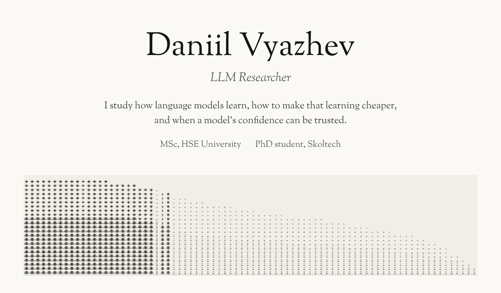
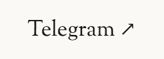
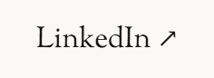
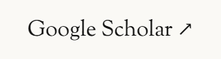
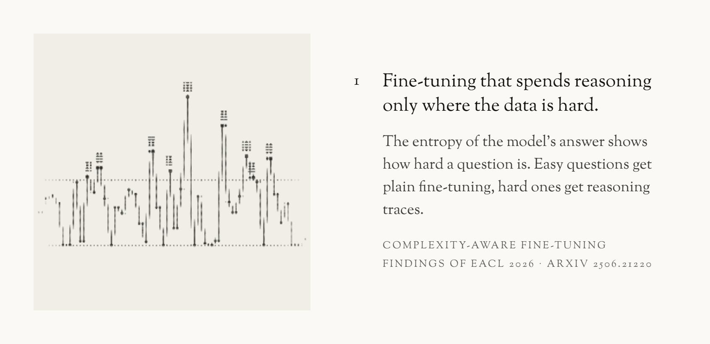
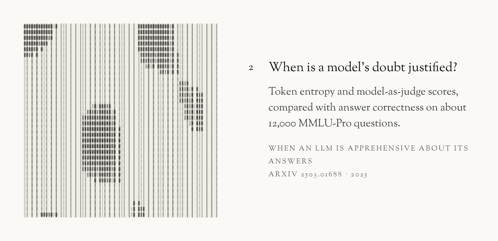
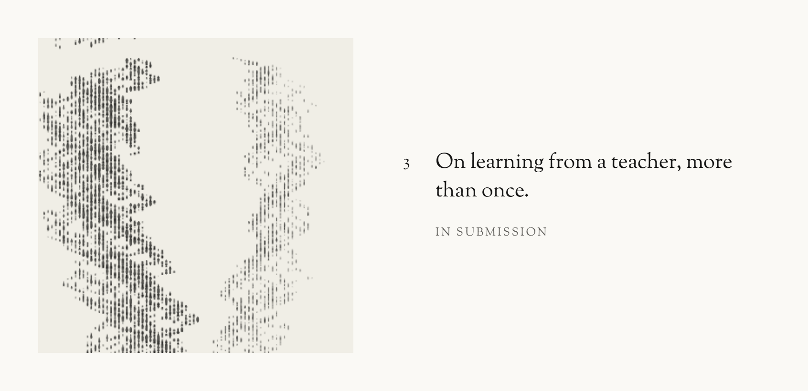
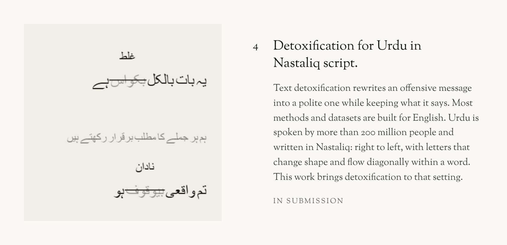
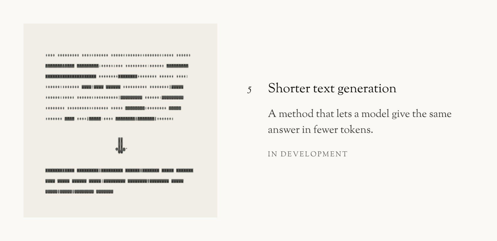

  

  
  
  

<a href="https://aclanthology.org/2026.findings-eacl.34/">Paper</a> · <a href="https://github.com/LabARSS/complexity-aware-fine-tuning">Code</a>

<a href="https://arxiv.org/abs/2503.01688">Paper</a> · <a href="https://github.com/LabARSS/question-complextiy-estimation">Code</a>

