

  <picture><source media="(prefers-color-scheme: dark)" srcset="assets/title-dark.png">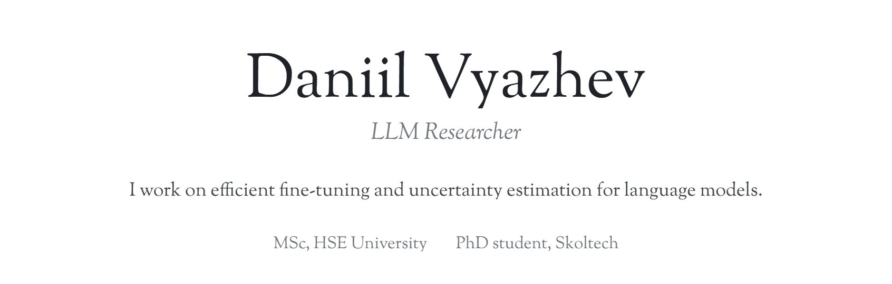</picture>

  <a href="https://t.me/danivyazhev"><picture><source media="(prefers-color-scheme: dark)" srcset="assets/link-tg-dark.png"></picture></a>
  <a href="https://www.linkedin.com/in/danivyazhev/"><picture><source media="(prefers-color-scheme: dark)" srcset="assets/link-li-dark.png"></picture></a>
  <a href="https://scholar.google.com/citations?user=0zpNAckAAAAJ&hl=en"><picture><source media="(prefers-color-scheme: dark)" srcset="assets/link-gs-dark.png"></picture></a>

  <picture><source media="(prefers-color-scheme: dark)" srcset="assets/strip-dark.png">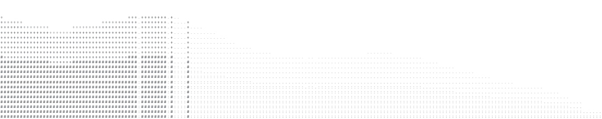</picture>

  <picture><source media="(prefers-color-scheme: dark)" srcset="assets/art-1-dark.png">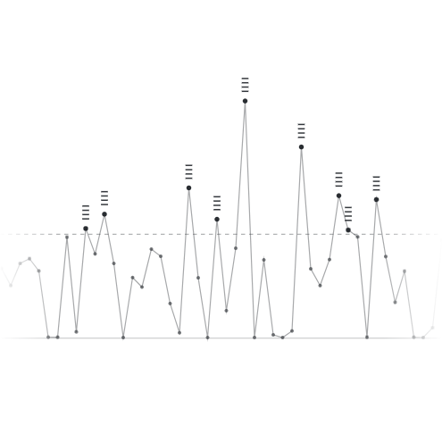</picture>
  <picture><source media="(prefers-color-scheme: dark)" srcset="assets/text-1-dark.png">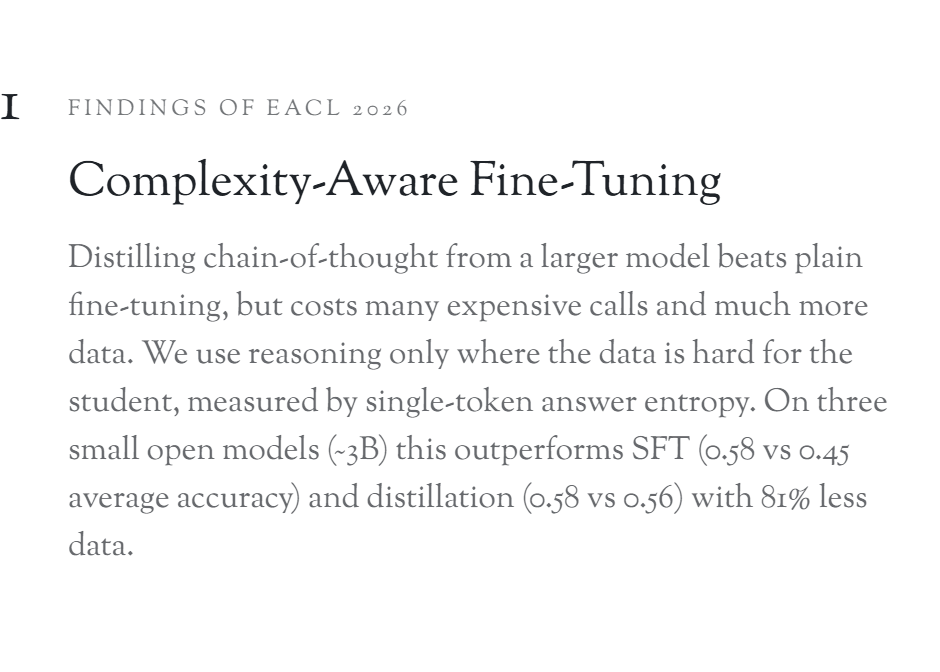</picture>

<a href="https://aclanthology.org/2026.findings-eacl.34/">Paper</a> · <a href="https://github.com/LabARSS/complexity-aware-fine-tuning">Code</a>

  <picture><source media="(prefers-color-scheme: dark)" srcset="assets/art-2-dark.png">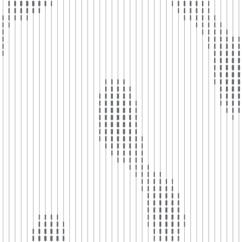</picture>
  <picture><source media="(prefers-color-scheme: dark)" srcset="assets/text-2-dark.png">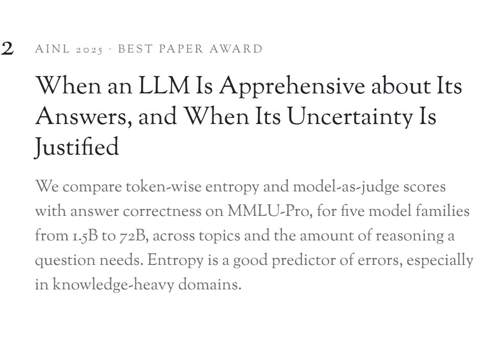</picture>

<a href="https://arxiv.org/abs/2503.01688">Paper</a> · <a href="https://github.com/LabARSS/question-complextiy-estimation">Code</a>

  <picture><source media="(prefers-color-scheme: dark)" srcset="assets/art-3-dark.png">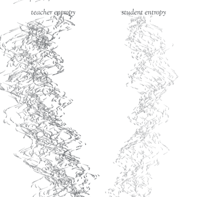</picture>
  <picture><source media="(prefers-color-scheme: dark)" srcset="assets/text-3-dark.png">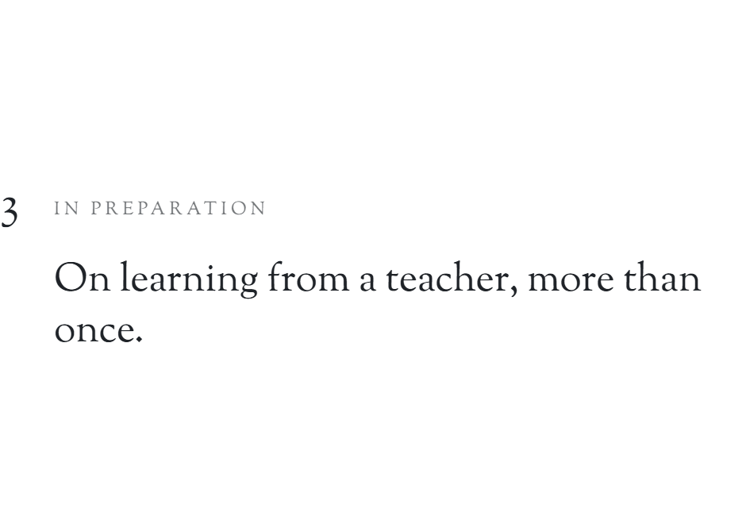</picture>

  <picture><source media="(prefers-color-scheme: dark)" srcset="assets/art-4-dark.png"></picture>
  <picture><source media="(prefers-color-scheme: dark)" srcset="assets/text-4-dark.png">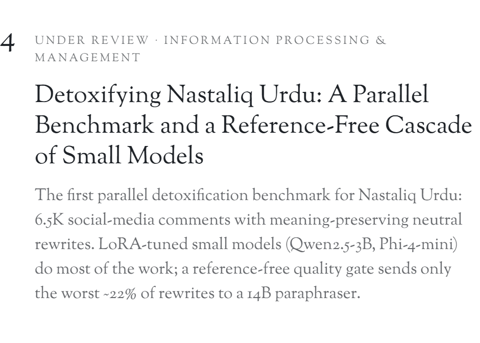</picture>

  <picture><source media="(prefers-color-scheme: dark)" srcset="assets/art-5-dark.png">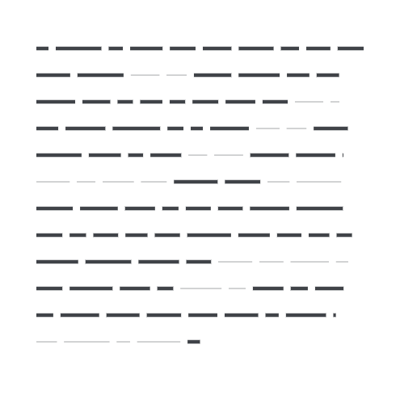</picture>
  <picture><source media="(prefers-color-scheme: dark)" srcset="assets/text-5-dark.png">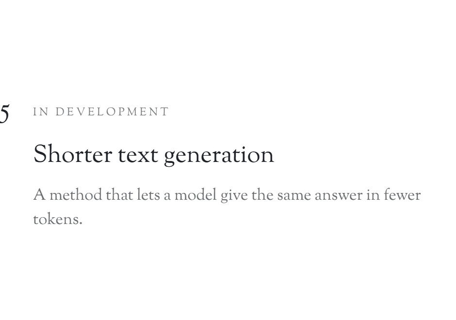</picture>

